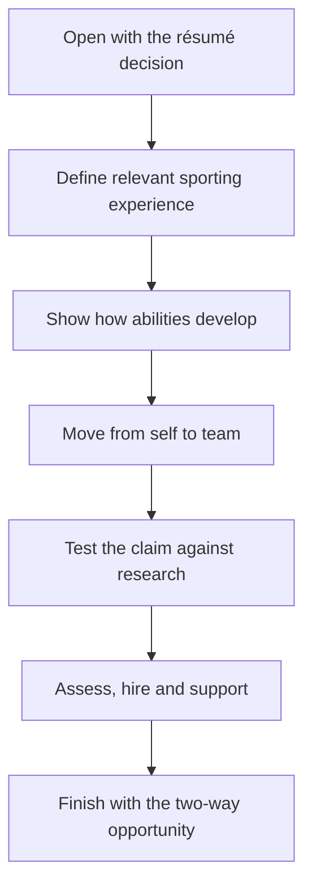
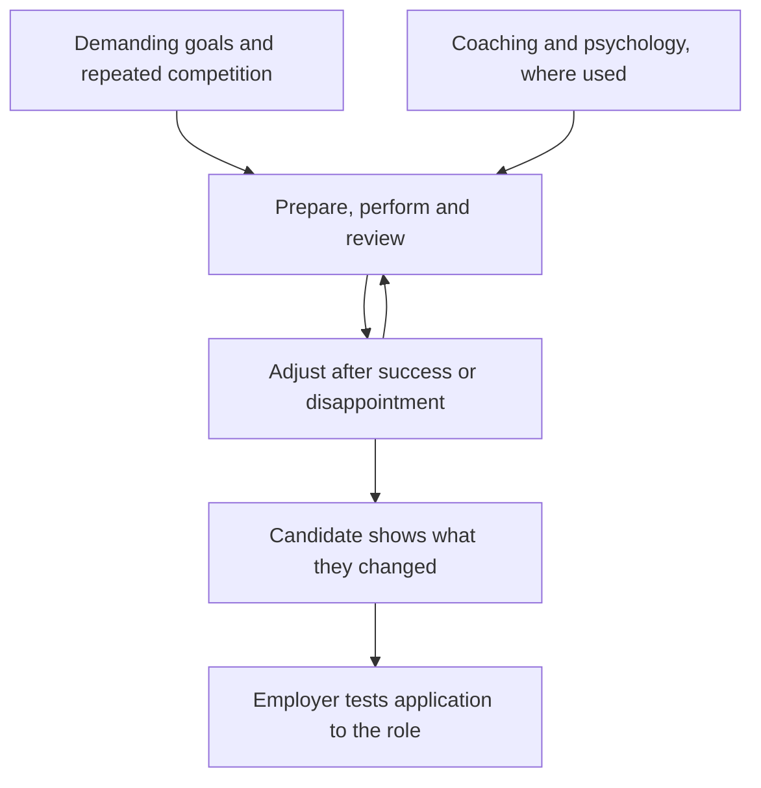
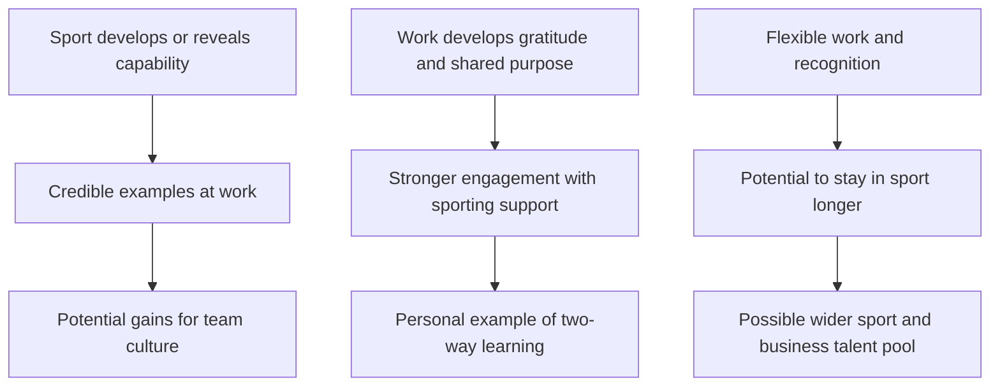

# Elite sport belongs under experience
## Research brief, argument map and editorial scorecard

**Audience:** Australian hiring managers, executives and people leaders. **Decision:** assess capabilities developed in sport against the role, at hiring and when assigning development opportunities. **Format:** an opinion piece of roughly 850–1,000 words, an employer interview guide, an athlete companion and an infographic.

### Working thesis

Sport at any level can give people practice in teamwork, preparation and responding to setbacks. Sustained elite sport can deepen that experience through repeated demanding cycles, accountability and, where used, specialist coaching and sports psychology. Count what the person learned and did as potentially relevant experience. Assess their technical readiness separately and give them room to apply those habits once hired.

The distinctions that govern the piece are participation versus demonstrated capability, getting noticed versus being hired, later occupational entry versus slower promotion, and senior relevance versus a proven increase in value with seniority. Prolonged participation gives repeated opportunities to learn. The research gathered here does not establish a year-by-year advantage. Quality of feedback, ownership, recovery and actual transfer matter more to the hiring argument than a count of seasons.

### Argument map for the writer

### Where each idea belongs

| Article beat | Job in the argument | Evidence and detail | Space |
|---|---|---|---:|
| 1. Résumé hook | Expose what a familiar CV format can miss | Imagine fifteen years of teamwork, independent work, scrutiny and adjustment. Ask whether that counts as experience. The consulting slide-pack comparison works as a question, rather than a documented preference. | 75–95 words |
| 2. Define the spectrum | Acknowledge social sport and explain the elite distinction | Football with mates can teach teamwork. Years of selection, training, recovery, camps and competition create different demands and may displace conventional full-time experience. | 75–95 |
| 3. Show the work | Make the thesis observable | Work backwards from selection. Plan across cycles. Prepare mentally and physically on race day. Review why a good or poor performance happened. Work through disappointment and decide whether to change or persist. Test new methods, keep what improves performance and retire what no longer helps. | 175–200 |
| 4. Raise the management test | Separate individual achievement from improving a team | Coaches and support staff matter even in individual sports. Praise, credit, gratitude and celebration affect how others contribute. Talent can carry someone whose behaviour harms a team. | 100–120 |
| 5. Tell the personal story | Demonstrate transfer in both directions | Working while competing helped Simon notice how much he relied on others. Gratitude, praise and greater vulnerability built trust. Keep the result as his lived assessment. | 100–120 |
| 6. Address the evidence | Give the reader confidence in the scope of the claim | One hiring finding and one counterpoint. Use senior studies or Rob Scott briefly. Integrity and public scrutiny can illustrate senior relevance if space permits. | 100–120 |
| 7. Show what employers can do | Turn recognition into a decision and a culture practice | Invite examples, assess technical readiness with a work sample, encourage learning and recognition after hiring, and make flexibility practical for active athletes. | 120–140 |
| 8. Add the AI aside and close | Add timely context, then return to the call | One short aside on changing tools and the relative value of learning and judgement. Mention the possible talent-pool effect briefly. End by telling athletes to carry what sport taught them into the next chapter. | 105–125 |

### Evidence register and limits

| Question | Findings to use | Implication and boundary |
|---|---|---|
| Does recreational sport help at the first screen? | Rooth’s Swedish field experiment found about **2 percentage points** more callbacks for CVs signalling leisure sport, with a larger effect in physically demanding jobs. [Study](https://doi.org/10.1016/j.labeco.2010.11.006) | A participation signal can help in some contexts. Callbacks cannot measure work performance. |
| Does college sport help? | Paul et al. sent paired applications to **more than 450 real vacancies**. No statistically significant overall callback or interview effect. The working paper reported 3.2 percentage points fewer interview requests for non-white applicants listing varsity sport. Dwyer and Gellock’s **235-person** résumé evaluation rated college sport at least as favourably as direct internships overall. [Field experiment](https://edworkingpapers.com/ai21-375) · [Evaluation](https://doi.org/10.1123/jis.2017-0037) | Actual screening and hypothetical ratings answer different questions. Keep the subgroup result tied to that study. These populations do not stand in for international athletes. |
| Is high-performance sport recognised? | A German experiment with **303 participants** found stronger hypothetical assessments for high-performance team sport versus no sport on an otherwise vocationally prepared profile. Neither comparison involving the individual-sport condition was statistically significant in the post-hoc tests. Interviews and focus groups with **65 employers across six European countries** identified positive qualities alongside concerns about occupational delay, required competencies and flexibility. [German experiment](https://doi.org/10.1007/s12662-024-00987-x) · [Employer conference abstract](https://researchportal.vub.be/en/publications/the-added-value-of-employing-active-and-former-elite-athletes-an-/) | The defensible mistake is failing to assess capabilities because the experience looks unfamiliar. Its prevalence is unknown. |
| Are athletes held back at promotion? | Ivy League varsity athletes reached more senior jobs in an observational NBER working paper. A retrospective study of **341 Swiss Olympians** found that a group with strong education and occupational experience was more often in professional or executive work outside sport five years after retirement. [Ivy League paper](https://www.nber.org/papers/w31753) · [Olympian study](https://doi.org/10.1177/10126902221123881) | These are attained positions. The comparison we need is promotion among similarly ready colleagues after entry, accounting for tenure, performance and opportunities. It remains unresolved. |
| Does athletic experience show up at senior levels? | Dong et al. found positive associations with firm outcomes in board data spanning **71 countries**. Chowdhury et al. linked NCAA athlete CEOs with stronger patent-based innovation outcomes. A separate study of **50,653 college students** found athlete status explained at most **0.1%** of variation in self-reported leadership outcomes. [Boards](https://doi.org/10.1016/j.intfin.2018.12.009) · [CEOs](https://doi.org/10.1111/eufm.70038) · [Leadership counterpoint](https://doi.org/10.3389/fspor.2025.1691139) | Use senior studies as evidence of relevance and association. They cannot tell us whether a sporting advantage grows with corporate rank or whether years of sport caused it. Rob Scott, an Olympic rowing silver medallist and Wesfarmers leadership example, provides illustration in one sentence. Recheck his title before publication. |
| What do athletes practise? | AIS teaches attention, stress and emotional management and Games preparation. Toering et al. found reflection and effort associated with elite status in **444 youth footballers**. A routine meta-analysis across **112 effect sizes** found a positive sporting-task effect under pressure, with wide uncertainty. ESSA recommends contextual debriefs. [AIS](https://www.ausport.gov.au/ais/mental_performance_in_competition/learn) · [Reflection](https://doi.org/10.1080/02640410903369919) · [Routines](https://doi.org/10.1080/1750984X.2021.1944271) · [Debriefing](https://doi.org/10.1007/s40279-026-02472-x) | Separate documented curriculum, self-reported habits and measured sporting performance. Ask what support the athlete used and what changed. Access and individual uptake vary. |
| How does preparation work? | A multiyear aim guides season planning. Macrocycles organise substantial preparation and competition periods, mesocycles organise focused blocks, and microcycles commonly organise about a week. Training load, rest and actual response inform adjustment. On race day the athlete may rehearse timing, meals, warm-up, focus cues and contingencies. [NSCA](https://www.nsca.com/education/articles/kinetic-select/hierarchical-structure-of-periodization-cycles/) · [AIS guidance](https://www.ausport.gov.au/ais/position_statements/training-load-in-relation-to-loading-and-unloading-phases-of-training) | Find out which decisions the coach made and which the athlete owned. The workplace analogy is linking strategy to daily activity while protecting capacity and adjusting when needed. |
| Can an athlete help or harm teammates? | Fransen et al. found different effects from supportive and undermining athlete leadership in a randomised youth football experiment. Lazear et al. studied how managers affect productivity and retention at one company. [Athlete leaders](https://doi.org/10.1371/journal.pone.0200480) · [Value of bosses](https://doi.org/10.1086/681097) | Both reinforce the importance of effects on others in their own settings. They do not establish that athletic success predicts good management. |
| What about fairness, media and reputation? | Sport Integrity Australia teaches anti-doping, ethical decisions and competition manipulation. Its 2025–26 report recorded **196,158 education completions or attendances**, including **177,635 eLearning completions**. AIS offers communications and social-media education. APRA and ASX material maps these concerns to risk culture, accountability and public disclosure. [Annual report, p. 37](https://www.sportintegrity.gov.au/sites/default/files/sia708-0626-annual-report-2025-26-accessible.pdf) · [AIS](https://www.ausport.gov.au/ais/networks/social-media-principles/education) · [APRA](https://www.apra.gov.au/risk-culture-10-dimensions) · [ASX](https://www.asx.com.au/about/regulation/corporate-governance-principles-and-recommendations) | The attendance totals count activity across the programme, including repeat participation and non-elite audiences. Training is a prompt to ask for actual judgement under pressure. |
| Can better recognition improve the talent pool? | Dual-career guidance documents scheduling and employment conflicts. Deloitte Ignite and PwC Australia’s pilot illustrate flexible routes to occupational experience. [EU guidance](https://doi.org/10.2766/52683) · [Deloitte](https://www.deloitte.com/au/en/careers/deloitte-life/ignite-athlete-program.html) · [PwC](https://www.pwc.com.au/media/2022/pwc-athlete-employment-program.html) | Recognition and practical flexibility could lower the perceived cost of staying in sport. Effects on participation, national results or the business talent pool remain hypotheses. |
| Why mention AI? | A field experiment with **758 consultants** found productivity and quality gains on tasks within the tool’s capabilities. WEF respondents expect flexibility, learning and leadership to grow in importance alongside technology skills. OECD emphasises complementary, technical and foundational knowledge. [Experiment](https://aiinstitute.hbs.edu/navigating-the-jagged-technological-frontier/) · [WEF](https://www.weforum.org/publications/the-future-of-jobs-report-2025/3-skills-outlook) · [OECD](https://www.oecd.org/en/publications/skills-in-the-ai-age_972bd15e-en/full-report/component-7.html) | As AI assists routine analysis and drafting, recall and production may carry less relative weight in some tasks. Judgement, domain expertise, experimentation and bringing a team through change still matter. An athlete-specific advantage is an inference. |

### Put the practical material in the companions

| Capability | Ask or listen for | Give them room to use it | Avoid |
|---|---|---|---|
| Honest review and recovery from disappointment | Ask what went wrong, their contribution, what changed and how they checked it. Ask what they learned from a success too. | Specific feedback and an agreed follow-up experiment | Blame and annual ratings with no actionable example |
| Mental preparation | Ask how they prepared for one high-pressure situation and what they changed when it stopped working. | Useful rehearsals, role clarity and calm debriefs | Treating visible nerves as a failure or expecting invulnerability |
| Planning and capacity | Ask how they worked backwards, what they owned and what disrupted the plan. | Clear milestones, priority trade-offs and recovery time | Permanent urgency or crediting a coach’s plan as the athlete’s |
| Technology adoption | Ask what they tried, what improved and which obsolete method they stopped using. | Time to compare tools and share results with colleagues | Rewarding novelty without evidence or preserving a process by default |
| Team contribution | Listen across success stories for who appears, what they did and how the athlete helped. | Give credit visibly and make shared review and celebration routine | Treating medals or pronouns as a shortcut to assessing leadership |
| Integrity and representation | Ask when doing the right thing put a result or selection at risk. | Clear boundaries, disclosure expectations and safe escalation | Assuming media polish or course completion proves judgement |
| Readiness for the role | Use the same job-relevant work sample and standards across candidates. | Teach domain skills and give ownership appropriate to readiness | Discounting relevant experience solely because it happened outside an office |

**Sports-to-role illustrations.** Football, rugby, netball and basketball can supply examples of live coordination and mutual accountability. Crew rowing and relays illustrate timing, reliability and handovers. Tennis and golf can surface autonomous decisions and resetting after mistakes. Running, swimming and triathlon illustrate pacing, recovery and preparation over time. Sailing can illustrate adaptation to changing conditions, and combat sports can illustrate composure and adjustment within rules. Use these as interview starting points. The research does not support ranking sports by managerial quality.

**Athlete companion.** Put sustained elite sport under experience and describe the demands, decisions, contribution and learning. Establish these behaviours while still competing. Seek feedback, recognise teammates, let coaches and support staff see where you need help, build trust and learn to review decisions honestly. Include the author’s account of bringing gratitude, praise and vulnerability from corporate work back into sport. The standalone Instagram discussion can ask where athletes put sport on a résumé and what response they received. Treat responses as leads for reporting, with consent for attributable examples.

**Infographic.** Lead with “Where does sport sit on your résumé?” Move through participation, sustained competition and demonstrated work-relevant capability. Use the preparation cycle as the central visual and finish with three prompts: “What did you own?”, “What did you change?” and “Who performed better because you were there?” Use separate evidence labels for field experiments, observational associations and hypotheses. Avoid ranking sports or suggesting an unmeasured dose-response curve.

### Editorial checks before submission

- State the hiring decision early. Frame widespread discounting as a question. Use the evidence that some employers already recognise sporting backgrounds.
- Read the story aloud and compare it to Simon’s dictation. Keep his examples personal. Verify dates and titles before publication and preserve the distinction between his account and measured outcomes.
- If the draft runs long, move the full sport taxonomy, detailed integrity figures, study limitations and interview prompts into the companions. Keep the AI aside brief.
- Test whether a hiring manager can name one concrete change to screening and one to onboarding after reading.
- The prior independent review scored the first draft **84.3/100** under the original rubric. Its main priorities were length, evidence mapping and technical readiness. That score stays with that draft and rubric.

### Working sources from this project

- [Elite_Sport_Is_Experience_Draft.md](https://chatgpt.com/library?file_id=libfile_f5b99b09a0f88191a1be4e88796797e0&account_id=personal)
- [Elite_Athletes_Psychology_Review_and_Planning_Evidence.md](https://chatgpt.com/library?file_id=libfile_33862cb397308191bb1cbc0ce7bd9007&account_id=personal)
- [Athlete_Integrity_Media_and_Senior_Leadership_Evidence.md](https://chatgpt.com/library?file_id=libfile_933f7bc23b388191abd7c1cc3b26bd7c&account_id=personal)
- [Elite_Athletes_Writing_Plan_and_Quotes.md](https://chatgpt.com/library?file_id=libfile_301159eabfe4819195058990ad50a23d&account_id=personal)
- [Elite_Sport_Independent_Review.md](https://chatgpt.com/library?file_id=libfile_b03364bbc02c819184fbfc693f49c175&account_id=personal)
- [Elite_Athletes_Article_and_Research.md](https://chatgpt.com/library?file_id=libfile_66830add400c8191a018df4015ef7663&account_id=personal)
- [Opinion_Piece_Rubric.md](https://chatgpt.com/library?file_id=libfile_1f0a500456c88191a28ed32f5548f662&account_id=personal)

---

## Scoring rubric and benchmark research

Research checked 15 November 2026. Version 1.0.

## What success means

A strong opinion piece earns attention, changes how a defined reader understands a consequential issue, and leaves a justified implication or action. Popularity, persuasion and social change are distinct outcomes. Writing quality can be assessed before publication; actual impact must be measured afterwards.

## Method and limitations

- This is a reasoned editorial rubric, not a scientifically validated virality predictor. The weights and thresholds below are design choices intended to make revision consistent.

- The benchmark set deliberately includes pamphlets, public letters, short opinion and reported magazine argument. Their mechanisms can inform an op-ed; their lengths, rhetoric and distribution cannot be copied as a universal template.

- Selection is purposive and biased toward survivors. Without comparable unsuccessful pieces, these cases cannot identify which features caused popularity. They generate hypotheses and craft standards, not causal estimates.

- Text and influence evidence are treated separately. Historical change is cumulative: movements, institutions, organising, events, access, editorial packaging and distribution all matter.

- Berger and Milkman (2012) link sharing with emotional activation, surprise, interest and practical utility using news data and experiments [R1]. This concerns transmission, not truth, persuasion or present-day platform reach.

- Braddock and Dillard (2016) report positive average relationships between narrative exposure and several persuasion outcomes [R2]. Effects vary; evidence for behaviour used only five studies. A story is not a substitute for representative evidence.

- An influential historical text need not satisfy every contemporary standard. This rubric borrows useful methods without endorsing each author’s politics, factual claims or omissions.

## Benchmark pieces: observed reception and transferable craft

### Thomas Paine: Common Sense (1776)

**Form:** Political pamphlet

**Observed reception:** Smithsonian documents rapid circulation and repeated editions. Published amid an existing independence debate; exact historical sales estimates differ.

**Craft analysis (editorial interpretation):** Makes the political choice accessible, challenges an inherited institution and addresses whether the proposed alternative is practicable.

**Transferable lesson:** Give readers a clear decision and answer the feasibility objection.

**Do not infer:** A pamphlet operating inside a revolutionary movement is not evidence that prose alone caused independence.

**Sources:** P1, P2

### Émile Zola: J’accuse (1898)

**Form:** Newspaper open letter

**Observed reception:** CNRS reports a 300,000-copy newspaper circulation and an international response. Zola faced prosecution; Dreyfus’s eventual exoneration followed a longer legal and political process.

**Craft analysis (editorial interpretation):** Addresses an accountable decision-maker, names alleged institutional failures and builds to repeated accusations.

**Transferable lesson:** Connect moral urgency to specific conduct, responsible institutions and a next step.

**Do not infer:** Do not imitate denunciation without verifiable evidence or confuse personal risk with proof of accuracy.

**Sources:** Z1, Z2

### Martin Luther King Jr.: Letter from Birmingham Jail (1963)

**Form:** Public letter / argumentative essay

**Observed reception:** Stanford documents circulation as a pamphlet, publication in several periodicals and inclusion of part in the Congressional Record.

**Craft analysis (editorial interpretation):** Answers actual objections, uses the audience’s moral vocabulary and makes the consequences of delay concrete.

**Transferable lesson:** Address the reasonable-seeming objection that keeps the status quo intact.

**Do not infer:** Its force also came from organising, the Birmingham campaign and moral circumstances; do not claim the letter alone produced legislation.

**Sources:** K1, K2

### Milton Friedman: The Social Responsibility of Business is to Increase its Profits (1970)

**Form:** Business opinion essay

**Observed reception:** A durable reference point in corporate-purpose debate. Historical scholarship disputes a simple story in which this essay caused shareholder primacy.

**Craft analysis (editorial interpretation):** States a portable proposition and derives its argument from an account of managerial responsibility.

**Transferable lesson:** Create a thesis readers can accurately repeat and examine its underlying assumptions.

**Do not infer:** Memorability and influence do not establish truth. Do not treat contested historical causation as settled.

**Sources:** F1, F2, F3

### Anne-Marie Slaughter: Why Women Still Can’t Have It All (2012)

**Form:** Personal / policy magazine essay

**Observed reception:** ABC described it as The Atlantic’s most-read piece at the time of a 2016 interview. Slaughter also discussed how the title could misrepresent her intended point.

**Craft analysis (editorial interpretation):** Pairs a demanding professional scene with personal conflict, then shifts the explanation toward workplace design.

**Transferable lesson:** Use a credible contradiction to expose an overlooked structural problem.

**Do not infer:** One high-status experience is not representative data; a provocative headline can overwhelm nuance.

**Sources:** S1, S2

### Ta-Nehisi Coates: The Case for Reparations (2014)

**Form:** Reported argument / magazine essay

**Observed reception:** CJR reported record readership and substantial multimedia investment. These establish reach and editorial support, not proof of policy enactment.

**Craft analysis (editorial interpretation):** Builds from a person’s experience to documented housing mechanisms and a broader argument; identifies a legislative hearing vehicle.

**Transferable lesson:** Make the mechanism visible through concrete evidence, then scale the stakes.

**Do not infer:** Long-form reporting and a major publisher’s resources cannot be reduced to a short-op-ed formula.

**Sources:** C1, C2

## The 100-point scorecard

| ID | Criterion | Weight |
|---|---|---:|
| C01 | Audience and intended change | 8 |
| C02 | Clear and contestable thesis | 8 |
| C03 | Stakes and relevance | 8 |
| C04 | Original insight or useful reframing | 9 |
| C05 | Opening that earns attention | 7 |
| C06 | Argument structure and momentum | 7 |
| C07 | Evidence quality and traceability | 12 |
| C08 | Reasoning, calibration and intellectual honesty | 8 |
| C09 | Fair treatment of objections and trade-offs | 8 |
| C10 | Concrete detail and earned emotional engagement | 6 |
| C11 | Voice, clarity and economy | 5 |
| C12 | Ending, implication and usable next step | 6 |
| C13 | Headline and memorable language | 3 |
| C14 | Natural writing style and author fidelity | 5 |

Rate 0–4; weighted points = weight × rating ÷ 4. The anchored ratings are 0, 2 and 4; use 1 and 3 for intermediate performance. A 100 means this version fully meets this rubric, not that it will go viral or change society.

## Detailed anchors and revision tests

### C01. Audience and intended change — 8 points

Who should think or act differently after reading?

| Rating | Anchor |
|---|---|
| 0 | No identifiable reader or change; the piece merely announces a concern. |
| 2 | A plausible audience and general recommendation are present, but the reader’s current belief or decision is unclear. |
| 4 | A specific reader, consequential decision and feasible shift are clear. The case connects to that reader’s responsibilities without flattering them. |

**Verification:** A reviewer can complete: For [reader], replace [current belief/practice] with [new belief/practice], because [reason].

**Revision:** Choose one primary audience and one intended change before revising sentences.

**Basis:** K1, Z1, E1; editorial synthesis

### C02. Clear and contestable thesis — 8 points

Can an attentive reader state the argument accurately in one sentence?

| Rating | Anchor |
|---|---|
| 0 | No thesis, incompatible theses, or a truism nobody could meaningfully dispute. |
| 2 | A position is identifiable but broad, buried or qualified until it has little meaning. |
| 4 | One precise, arguable proposition controls the piece. Its scope and conditions are clear, and it appears early enough for the format. |

**Verification:** Have a reader paraphrase the claim without seeing the headline. Compare it with the writer’s intended claim.

**Revision:** Write the thesis as a decision or explanatory claim, remove competing promises and align the body.

**Basis:** F1, P1, E1; editorial synthesis

### C03. Stakes and relevance — 8 points

What changes for the reader or other people if this argument is right?

| Rating | Anchor |
|---|---|
| 0 | Abstract importance is asserted with no meaningful consequence. |
| 2 | Consequences are named but generic, remote or weakly linked to the reader. |
| 4 | The piece makes benefits, costs of inaction and affected people concrete. It explains the present relevance without manufacturing a crisis. |

**Verification:** Underline the exact passages answering why care and why this matters in the intended publication context.

**Revision:** Replace vague importance with a specific consequence, opportunity cost or decision. Use a genuine news peg only when it exists.

**Basis:** K1, S1, Z1; editorial synthesis

### C04. Original insight or useful reframing — 9 points

What does the reader understand differently that a generic article would not provide?

| Rating | Anchor |
|---|---|
| 0 | Familiar slogans, summary or contrarianism with no new explanation. |
| 2 | A fresh observation is present, but the mechanism or implications are not developed. |
| 4 | A clear, defensible reframing connects familiar facts in a useful way, explains what the default account misses and changes how a decision is evaluated. |

**Verification:** State the before/after understanding. Test whether the claimed insight survives removal of provocative wording.

**Revision:** Name the assumed model, show its blind spot, and explain the better interpretation with evidence.

**Basis:** S1, C1, F1; R1 supports interest/surprise, not a novelty guarantee

### C05. Opening that earns attention — 7 points

Does the opening create a relevant reason to continue?

| Rating | Anchor |
|---|---|
| 0 | Throat-clearing, a disconnected anecdote, unsupported shock or a false promise. |
| 2 | A relevant opening with some tension, but slow delivery or an unclear link to the thesis. |
| 4 | A concrete contradiction, scene, question or fact creates immediate tension and moves efficiently into the argument. The body pays off its promise. |

**Verification:** Read only the first two paragraphs: identify both the tension and the argument they prepare.

**Revision:** Start at the consequential conflict; remove ceremonial context. Verify any opening fact or comparison.

**Basis:** S1, C1, E1; narrative findings R2 offer support with limits

### C06. Argument structure and momentum — 7 points

Does each section make the next conclusion easier to accept?

| Rating | Anchor |
|---|---|
| 0 | A list of claims with missing warrants, circular logic or unrelated digressions. |
| 2 | A logical outline exists, but repetition, weak transitions or a crowded middle dilute it. |
| 4 | Each paragraph advances the case: claim, relevant support, explanation and consequence. The sequence resolves reader questions while maintaining forward motion. |

**Verification:** Label each paragraph’s job. Remove or merge duplicates. Check that evidence is connected to the conclusion it is meant to support.

**Revision:** Reorder around the reader’s questions, not the research chronology. Cut a paragraph that contributes neither reason, evidence nor necessary transition.

**Basis:** P1, K1, C1, E1; editorial synthesis

### C07. Evidence quality and traceability — 12 points

Can the strongest factual claims survive inspection of the underlying sources?

| Rating | Anchor |
|---|---|
| 0 | Invented, materially wrong or unverifiable central evidence; quotations or statistics are misattributed. |
| 2 | Relevant support is present, but source quality, context, representativeness or claim-to-source matching is uneven. |
| 4 | Every material empirical claim has suitable, traceable support. Key studies, quotations, dates, definitions and figures are checked. Anecdotes illustrate rather than establish prevalence. |

**Verification:** Create a claim ledger: exact assertion, source location, what was measured, population, limitations and verification status.

**Revision:** Repair the weakest central support before polishing. Prefer the original study/document when possible and remove claims that cannot be responsibly supported.

**Basis:** C1, Z1; contemporary verification standard, not a score inherited from famous examples

### C08. Reasoning, calibration and intellectual honesty — 8 points

Does the strength of the conclusion match the evidence?

| Rating | Anchor |
|---|---|
| 0 | Association becomes causation, a subgroup becomes everyone, or a hypothetical pathway is presented as a measured effect. |
| 2 | Some qualifications are present, but causal steps, alternative explanations or limits are inconsistent. |
| 4 | Facts, interpretations, values and proposals are distinguishable. Major assumptions and uncertainty are explicit at the relevant point; the recommendation remains clear and proportionate. |

**Verification:** Audit words such as causes, proves, always, best and will. Trace each causal link and identify what could break it.

**Revision:** Narrow the claim, explain the assumption or label the mechanism as a hypothesis. Do not bury a correction to an overstated headline.

**Basis:** F2, F3 demonstrate attribution risk; R1/R2 show limits of generalisation

### C09. Fair treatment of objections and trade-offs — 8 points

Would a thoughtful sceptic recognise their strongest objection?

| Rating | Anchor |
|---|---|
| 0 | Opponents are caricatured, motives invented or the decisive objection ignored. |
| 2 | An objection is mentioned but weakly stated, answered with assertion or parked in a token concession. |
| 4 | The most consequential objection is fairly formulated and answered with reasoning or evidence. Genuine costs and limits affect the recommendation where necessary. |

**Verification:** Write the strongest objection in terms its supporter would accept. Check whether the answer changes the case rather than merely restating it.

**Revision:** Address the objection that could actually invalidate the thesis. Concede what is true and revise the proposed action accordingly.

**Basis:** K1, P1; editorial synthesis

### C10. Concrete detail and earned emotional engagement — 6 points

Can the reader picture the problem and feel why it matters without being manipulated?

| Rating | Anchor |
|---|---|
| 0 | Abstract language, stereotypes, fabricated scenes or emotional pressure replacing reasons. |
| 2 | A relevant example or emotional cue is present but ornamental, unrepresentative or weakly connected to the mechanism. |
| 4 | Specific people, choices, processes or comparisons make the mechanism intelligible. Emotion follows warranted stakes; scope and representativeness are clear. |

**Verification:** Find one passage a reader can picture and explain what it proves, illustrates or leaves unresolved.

**Revision:** Replace one abstract claim with a verified scene, example or process. Avoid identifying vulnerable people unnecessarily or staging a false anecdote.

**Basis:** S1, C1, K1; R1/R2 support engagement mechanisms, not manipulation

### C11. Voice, clarity and economy — 5 points

Does the prose sound like a particular person thinking clearly?

| Rating | Anchor |
|---|---|
| 0 | Jargon, imitation, filler or generic exhortation obscures the argument. |
| 2 | Mostly readable prose with some distinctive judgement, but repetition and predictable transitions remain. |
| 4 | Precise verbs, concrete nouns, varied rhythm and proportionate confidence sustain an identifiable voice. Every paragraph earns its length and technical terms are explained. |

**Verification:** Read aloud and perform a deletion pass. Ask a reader to mark where they reread or skim. Judge effects, not an alleged AI-writing detector.

**Revision:** Replace abstractions with actions, cut repeated conclusions and rewrite stock phrasing in the author’s own vocabulary.

**Basis:** P1, E1; editorial synthesis

### C12. Ending, implication and usable next step — 6 points

Does the piece leave the reader with a justified change they can carry forward?

| Rating | Anchor |
|---|---|
| 0 | Stops abruptly, repeats the introduction or substitutes a grand wish for a conclusion. |
| 2 | Summarises the argument and suggests change, but ownership, feasibility or the final implication is weak. |
| 4 | The ending follows from the case, names an appropriate next step or durable question and resolves the opening tension. Practical actions have an owner and realistic scope. |

**Verification:** Cover the final paragraph and predict what should follow. Compare with the actual ending; identify who can do what.

**Revision:** End on the consequence or action earned by the evidence. Do not bolt on a poll or question solely to solicit comments.

**Basis:** C1, Z1, E1; editorial synthesis

### C13. Headline and memorable language — 3 points

Can the central idea travel accurately beyond the page?

| Rating | Anchor |
|---|---|
| 0 | Clickbait, a headline/body mismatch, a misleading statistic or memorable phrasing unsupported by the piece. |
| 2 | Accurate packaging with a recognisable idea, but generic language or a quote that loses essential conditions. |
| 4 | A specific, truthful headline and at least one portable expression capture the argument. Shared snippets preserve meaning and source context; distinctiveness serves understanding. |

**Verification:** Read headline and excerpt without the body. Ask what a sharer would claim; compare it with the substantiated thesis.

**Revision:** Tighten the title’s promise and write one accurate sentence that preserves the core claim. Remove language that overstates merely to travel.

**Basis:** F1, Z1, S2; R1 informs sharing, not the correctness of shared beliefs

### C14. Natural writing style and author fidelity — 5 points

Score the prose on how it reads and how closely it reflects the author. Use C11 for clarity and economy, and C14 for cadence, specificity and fidelity to Simon’s spoken voice.

| Rating | Anchor |
|---|---|
| 0 | Generic motivational copy, stock contrasts, repeated paragraph formulas or personal details unsupported by the author’s account. |
| 2 | Mostly readable prose with some recognisable author language, but several sentences could sit unchanged in any leadership article. |
| 4 | The piece sounds natural aloud. It uses concrete actions, specific observations, variable sentence rhythm and the author’s own phrasing where it fits. Each paragraph moves the argument forward. |

**Verification:** Read the opening, anecdote and close aloud. Mark phrases Simon would be unlikely to say, generic transitions, excessive symmetry and claims that could apply to anyone. Give two examples from the draft when scoring. Assess reader-facing qualities without using an AI detector or inferring who wrote the text.

**Revision:** Return to the dictation for precise wording. Replace vague abstractions with actions and consequences. Cut repeated conclusions and generic motivational language. Preserve Australian English, the author’s first-person account and the limits of what he actually said.

## Publication gates (separate from the score)

- **G1 / Material accuracy:** No fabricated quotation, source, statistic, anecdote or materially false central assertion.

- **G2 / Support and framing:** Central evidence is checkable; the headline and body do not materially misrepresent the evidence or causal claim.

- **G3 / Originality and attribution:** No plagiarism or disguised borrowing; quotations and substantive source-dependent claims are appropriately attributed.

- **G4 / Fairness and responsible disclosure:** No knowingly misleading omission, unsupported allegation or deceptive conflict-of-interest presentation; necessary privacy and consent issues are resolved.

- **G5 / Publication fit:** Rights, length, format and outlet-specific requirements are met. Editorial and legal review is sought when the actual content warrants it.

A failed or unresolved gate blocks readiness; do not quietly convert it into a small point deduction. A historical benchmark’s influence does not waive these checks for a new draft.

## Review and revision workflow

1. Write the brief: primary audience, intended belief/action change, venue, length, core claim, strongest objection and available evidence.

2. Run the five gates before scoring. Record pass, fail or unknown with a reason. Fail or unknown blocks a publication-ready verdict, regardless of points.

3. Build the material-claim ledger. Separate source findings from the author’s interpretation and proposal. Verify the strongest claims and quotations first.

4. Score each criterion from 0 to 4 with a passage location and an explanation. Use the 0/2/4 anchors; 1 and 3 are genuine intermediate levels. Do not award credit for content only present in the writer’s notes.

5. Calculate total = sum(weight × rating / 4). Report it to one decimal. Do not average away a weak central-evidence or reasoning score.

6. Revise the three highest-consequence weaknesses first. Prioritise false/unsupported claims, unclear thesis and the decisive objection before line-level polish.

7. Use two reading roles, whether performed by people or in separate review passes: the intended reader and the fair-minded sceptic. Do not claim independent review if the same reviewer simply rescored their own work.

8. Repeat only where the revision changes scores, evidence or risk. Keep a change log. Do not chase 100 by padding, diluting the thesis or flattering the reviewer.

9. Recommended editorial threshold: gates clear, total at least 85, and C02/C07/C08/C09 each at least 3. A 95+ draft is exceptional under this rubric; it is not guaranteed to persuade or spread.

10. Stop when the brief is met, material issues are resolved and further changes do not produce substantive improvement. Preserve unresolved source gaps and publish-readiness separately from the total.

## Measure outcomes separately

| Outcome | Useful measure | Do not confuse it with |
|---|---|---|
| Reach | Qualified unique readers within a declared window; compare with the same venue, format and placement. | Raw impressions without an exposure denominator. |
| Engagement | Completion, engaged reading time, saves and meaningful return visits, normalised for length where possible. | Clicks or comments treated as evidence of agreement. |
| Transmission | Shares per qualified reader, referral paths and whether excerpts preserve the thesis. | Raw shares treated as persuasion or accurate understanding. |
| Persuasion | A stated belief or intended decision assessed before/after or in a credible comparison design. | Uncontrolled reader testimony presented as a causal estimate. |
| Agenda influence | Substantive citations, responses from relevant decision-makers, hearings or changed framing, with dates and attribution limits. | Any media mention labelled a change in society. |
| Action and durability | Verified practice/policy change, uptake by the intended audience and sustained use; record other contributing forces. | Attributing a complex social change to one article. |

Record timing, venue, distribution, author platform, editorial support and contemporaneous events. Label missing metrics unknown, not zero. Do not add this dashboard to the 100-point writing score.

## Applying it to the elite-athlete article

- **Audience/change:** Target hiring managers and executives. Ask them to recognise sustained elite sport as relevant experience and assess actual contribution.

- **Reframing:** Treat an apparent CV gap as experience the current recruitment frame may fail to recognise. The slide-pack comparison is a provocation to examine, not evidence that consulting work lacks value.

- **Evidence boundary:** CEO/board findings support relevance at senior levels. They do not establish an increasing advantage with rank or a more-years/better-leader relationship.

- **Strongest objection:** A gifted athlete may succeed despite poor teamwork; formal business competence still matters. Answer through behavioural evidence, real work tasks and demonstrated improvement of others.

- **Wider benefit:** Present recognition/support → participation/retention → development → business talent as a prospective pathway. Do not claim a measured medal-count or workforce effect.

- **Packaging:** Keep one primary thesis in the body. Put sport mappings and the employer playbook in companions; avoid turning a short opinion piece into a catalogue of benefits.

## Sources

Source IDs refer to the originals and supporting reception evidence. Links checked through search/open retrieval; some full pages may be access-restricted. No historical circulation estimate is treated as a modern comparable readership metric.

- **[P1] Paine, Common Sense (1776), original text:** https://www.gutenberg.org/files/147/147-h/147-h.htm

- **[P2] Smithsonian, An Eloquent Argument: reach and context:** https://www.si.edu/collections/snapshot/eloquent-argument

- **[Z1] Zola, J’accuse (1898), Georgetown translation by Temchin and Guieu:** https://jean-max-guieu.facultysite.georgetown.edu/other-interests/english-translation-of-emile-zolas-jaccuse/

- **[Z2] CNRS, How the Dreyfus Affair Went Global (2019):** https://news.cnrs.fr/articles/how-the-dreyfus-affair-went-global

- **[K1] King, Letter from Birmingham Jail (1963), full text:** https://www.crmvet.org/docs/bhamlbj.htm

- **[K2] Stanford King Institute, publication and circulation history:** https://kinginstitute.stanford.edu/letter-birmingham-jail

- **[F1] Friedman, The Social Responsibility of Business is to Increase its Profits (1970), university-hosted text:** https://public.websites.umich.edu/~thecore/doc/Friedman.pdf

- **[F2] Cheffins, Stop Blaming Milton Friedman! (2021), Washington University Law Review:** https://journals.library.wustl.edu/lawreview/article/id/4411/

- **[F3] The Intellectual History of Milton Friedman’s Criticism of Corporate Social Responsibility, Modern Intellectual History:** https://www.cambridge.org/core/journals/modern-intellectual-history/article/intellectual-history-of-milton-friedmans-criticism-of-corporate-social-responsibility/C126A32BDDF35994207EA6141AAC7FA8

- **[S1] Slaughter, Why Women Still Can’t Have It All (2012), The Atlantic:** https://www.theatlantic.com/magazine/archive/2012/07/why-women-still-cant-have-it-all/309020/

- **[S2] ABC Lateline interview with Slaughter (4 March 2016):** https://www.abc.net.au/lateline/archive/articles/2016/03/04/s4419232.htm

- **[C1] Coates, The Case for Reparations (2014), The Atlantic:** https://www.theatlantic.com/magazine/archive/2014/06/the-case-for-reparations/361631/

- **[C2] Columbia Journalism Review, interview and readership record report (2014):** https://www.cjr.org/minority_reports/atlantic_buzzfeed_tanehisi_coa.php

- **[R1] Berger and Milkman (2012), What Makes Online Content Viral?, Journal of Marketing Research:** https://doi.org/10.1509/jmr.10.0353

- **[R2] Braddock and Dillard (2016), narrative persuasion meta-analysis, Communication Monographs:** https://doi.org/10.1080/03637751.2015.1128555

- **[E1] University of Toronto, Tips for Writing Opinion Editorials:** https://www.utm.utoronto.ca/communications/media-relations/resources-faculty/tips-writing-opinion-editorials

